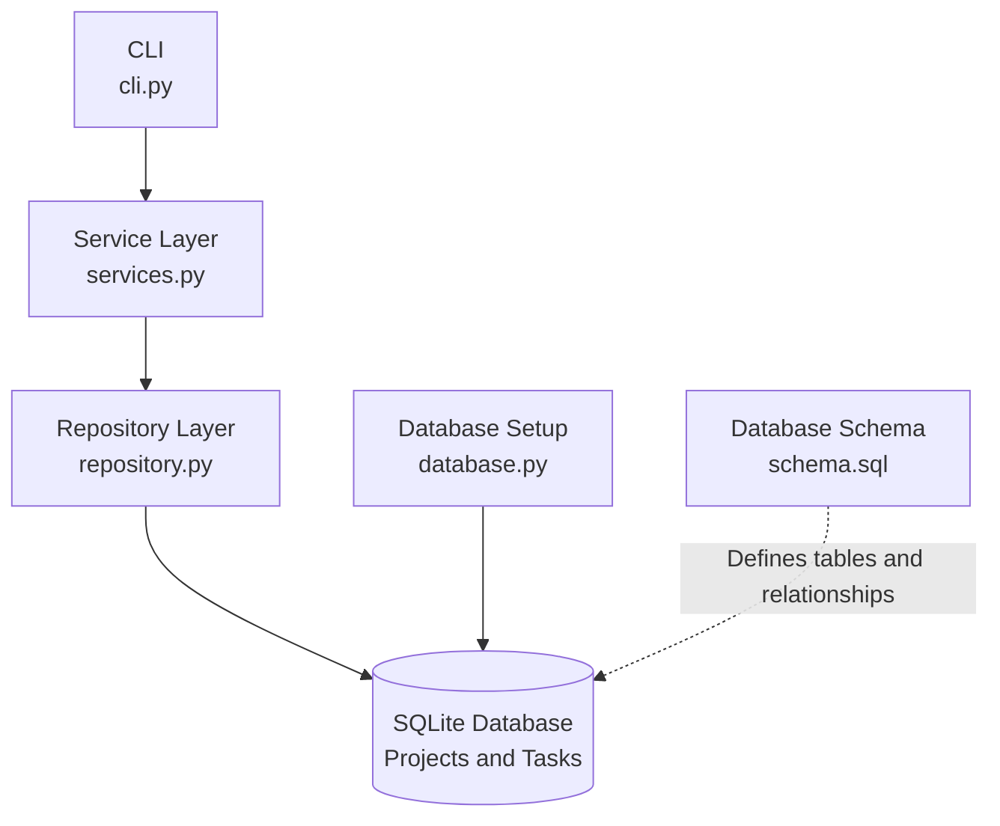

# Database-Backed Task Manager

A command-line task management application built with Python and SQLite. It uses a layered architecture to separate command-line interaction, business logic, database operations, and data storage.

## Features

- Create projects and associate tasks with projects
- Create tasks with titles and optional descriptions
- List all tasks
- View an individual task by ID
- Update task titles
- Delete tasks
- Validate user input in the service layer
- Enforce database relationships using SQLite foreign keys
- Handle validation and database errors
- Test application behavior using pytest

## Tech Stack

- **Language:** Python 3.11+
- **Database:** SQLite
- **CLI:** argparse
- **Testing:** pytest
- **Packaging and configuration:** pyproject.toml

## Project Structure

```text
Database-Task-Manager/
├── src/
│   └── task_manager/
│       ├── __init__.py
│       ├── cli.py
│       ├── database.py
│       ├── services.py
│       └── repository.py
├── tests/
├── data/
├── schema.sql
├── pyproject.toml
├── .gitignore
└── README.md
```

## Architecture

The application uses a layered architecture to separate command-line interaction, business logic, database operations, and storage.



### Layer Responsibilities

- **CLI (`cli.py`):** Parses user commands and displays results.
- **Service Layer (`services.py`):** Validates input and coordinates application operations.
- **Repository Layer (`repository.py`):** Executes SQL queries against the database.
- **Database Layer (`database.py`):** Creates database connections and initializes the schema.
- **Schema (`schema.sql`):** Defines the database tables and their relationships.
- **SQLite:** Stores project and task records persistently.

The main request flow is:

`CLI → Services → Repository → SQLite`

## Setup

### 1. Clone the repository

```bash
git clone https://github.com/Anashritam/Database-Task-Manager.git
cd Database-Task-Manager
```

### 2. Create a virtual environment

```bash
python -m venv .venv
```

Activate it on Windows:

```powershell
.venv\Scripts\Activate.ps1
```

### 3. Install the project

Install the project in editable mode with its development dependencies:

```bash
python -m pip install -e ".[dev]"
```

## Usage

Run the commands from the project root.

### View available commands

```bash
python -m task_manager.cli --help
```

### Create a project

```bash
python -m task_manager.cli project create "Research"
```

Use the project ID returned by the command when creating a task.

### Create a task

```bash
python -m task_manager.cli create 1 "Prepare research notes"
```

Add an optional description:

```bash
python -m task_manager.cli create 1 "Prepare research notes" --description "Collect and organize sources"
```

Replace `1` with an existing project ID.

### List tasks

```bash
python -m task_manager.cli list
```

### View a task

```bash
python -m task_manager.cli show 1
```

### Update a task title

```bash
python -m task_manager.cli update 1 "Review research notes"
```

### Delete a task

```bash
python -m task_manager.cli delete 1
```

Replace example IDs with the IDs of the records in your database.

## Database

The application uses SQLite for persistent storage. The database is initialized from `schema.sql` and stored at:

```text
data/task_manager.db
```

The task-to-project relationship uses a foreign key, helping prevent tasks from referencing projects that do not exist.

## Run Tests

Run the test suite from the project root:

```bash
python -m pytest
```

The current development test suite has passed **27 tests**.

## Engineering Concepts Practiced

- Layered application architecture
- Separation of concerns
- Python modules and imports
- Command-line argument parsing
- Input validation
- SQLite database operations
- Foreign key constraints
- Database transactions
- Exception handling and resource cleanup
- Automated testing with pytest
- Python project packaging and metadata

## Future Improvements

Potential extensions include task status and priority management, improved command-line output, and additional integration tests.

These are possible future enhancements, not claims about additional functionality currently implemented.
